# 🛍️ Mall Shopper Segmentation — Unsupervised Learning

Segmenting mall customers with **K-Means**, **Agglomerative Hierarchical Clustering** and **DBSCAN**, then turning the clusters into retail personas and business strategies.

---

## 📌 Table of Contents
1. [Project Overview](#-project-overview)
2. [Dataset](#-dataset)
3. [Tech Stack](#-tech-stack)
4. [Project Workflow](#-project-workflow)
5. [Exploratory Data Analysis](#-exploratory-data-analysis)
6. [Feature Engineering & Preprocessing](#-feature-engineering--preprocessing)
7. [K-Means Clustering](#-k-means-clustering)
8. [Agglomerative Hierarchical Clustering](#-agglomerative-hierarchical-clustering)
9. [DBSCAN](#-dbscan)
10. [Algorithm Comparison](#-algorithm-comparison)
11. [Customer Personas & Retail Strategy](#-customer-personas--retail-strategy)
12. [Deployment: `classify_shopper()`](#-deployment-classify_shopper)
13. [Folder Structure](#-folder-structure)
14. [How to Run](#-how-to-run)
15. [Key Takeaways](#-key-takeaways)

---

## 🎯 Project Overview

A mall wants to understand **who its shoppers are** so it can target marketing, store placement and loyalty programs better. Since there are no labels, this is an **unsupervised learning** problem.


🔗 **Project Explanation:** [Watch / View on Google Drive](https://drive.google.com/file/d/1EMMM1aljU3El7V3K7HHWlPl0KJ4Lq2Tc/view?usp=sharing)

---
**Goals**
- Explore and understand the customer data (EDA)
- Cluster customers using three different algorithms
- Compare algorithms with internal metrics (Silhouette, Davies-Bouldin, Calinski-Harabasz)
- Convert clusters into **business personas** with retail strategies
- Save the best model and build a function to classify new shoppers

---

## 📊 Dataset

**File:** `Dataset/Mall_Customers.csv` — 200 customers, 5 columns, **no missing values**.

| Column | Description |
|---|---|
| `CustomerID` | Unique customer ID |
| `Gender` | Male / Female (112 Female, 88 Male) |
| `Age` | Customer age (18–70) |
| `Annual Income (k$)` | Annual income in thousand dollars |
| `Spending Score (1-100)` | Score assigned by the mall based on spending behaviour |

Columns were renamed to `Gender`, `AnnualIncome` and `SpendingScore` for convenience.

---

## 🧰 Tech Stack

- **Language:** Python
- **Libraries:** NumPy, Pandas, Matplotlib, Seaborn, Scikit-learn, SciPy, Joblib
- **Environment:** Jupyter Notebook

---

## 🔄 Project Workflow

```
Data Loading → EDA → Feature Engineering → Scaling
      → K-Means → Hierarchical → DBSCAN
      → Metric Comparison → Personas & Strategy → Saved Model + classify_shopper()
```

---

## 🔍 Exploratory Data Analysis

### Univariate Analysis

| Distributions | Gender Count |
|:---:|:---:|
| 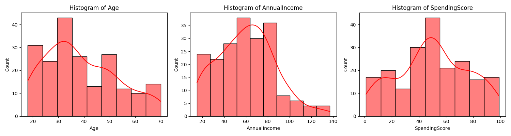 | 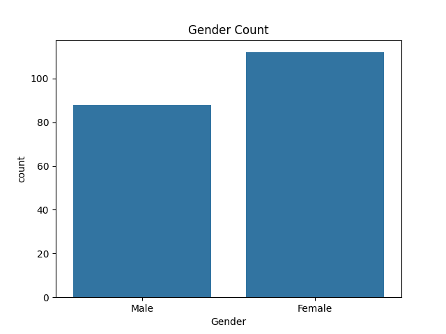 |

- **Age** is right-skewed — most shoppers are 25–50.
- **AnnualIncome** is roughly bell-shaped, centred near 60 k$; only 2 mild outliers (137 k$), which were kept.
- **SpendingScore** is nearly symmetric and spread across 1–99.
- Gender is fairly balanced (56% female / 44% male).

### Bivariate Analysis

**Annual Income vs Spending Score** — five compact groups are visible even before clustering:

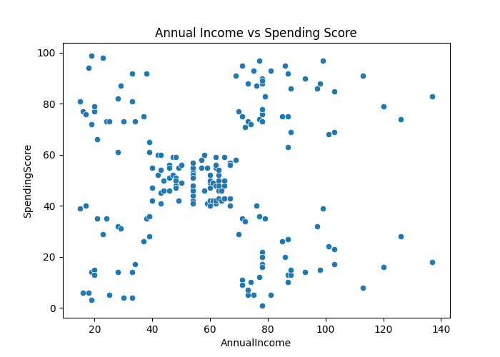

**Age vs Spending Score / Annual Income** (coloured by gender):

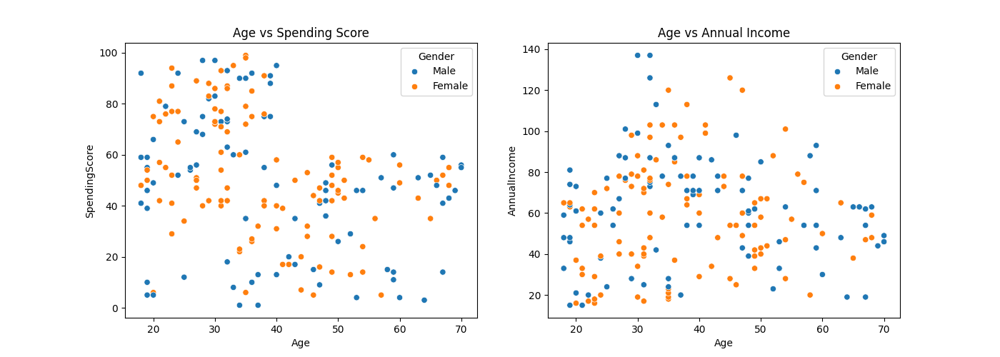

**Correlation Heatmap**

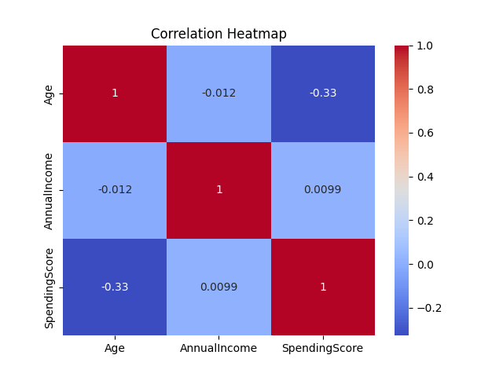

- All correlations are weak. Strongest: **Age vs SpendingScore = −0.33** (older shoppers spend a bit less).
- Income vs SpendingScore ≈ **0.01** → income does not predict spending, which is why clustering on those two features reveals distinct personas.

### Gender-Wise Summary

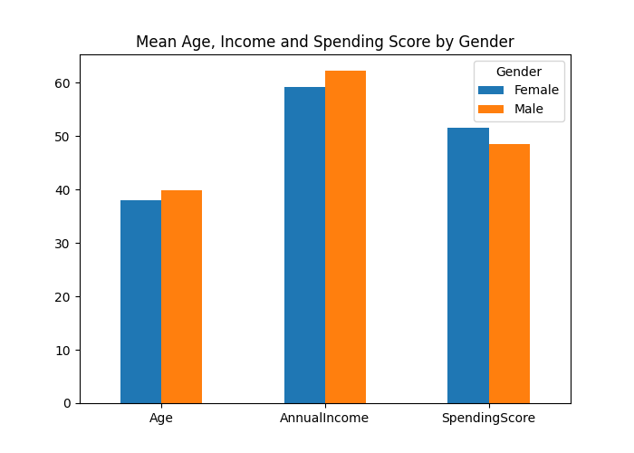

Gender differences are small (about 3 points on a 100 scale), so gender is **not** a strong driver of segmentation.

---

## ⚙️ Feature Engineering & Preprocessing

- Encoded `Gender` (Female = 0, Male = 1).
- Created `IncomeGroup` (qcut), `AgeGroup` and `SpendingCategory` (cut) features.
- Two experiments:
  - **Experiment A (2D):** `AnnualIncome`, `SpendingScore`
  - **Experiment B (4 features):** `Age`, `AnnualIncome`, `SpendingScore`, `Gender_enc`
- Applied `StandardScaler` to all features before clustering.

---

## 🔵 K-Means Clustering

### Choosing k — Elbow & Silhouette

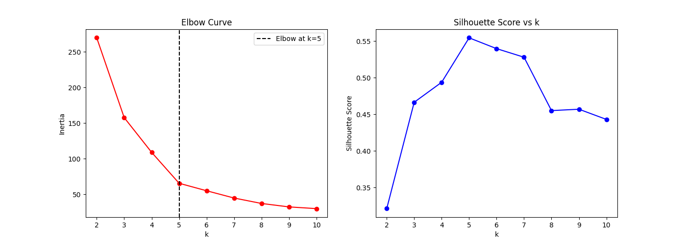

Both the elbow curve and the Silhouette Score point to **k = 5** (Silhouette = **0.5547**).

### Cluster Visualisation

**Income vs Spending Score (with centroids):**

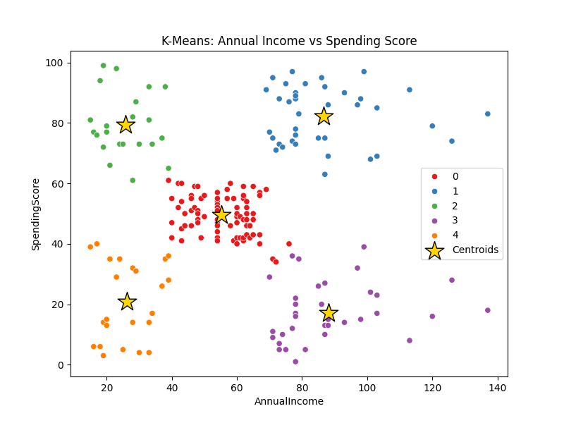

**Age vs Spending Score:**

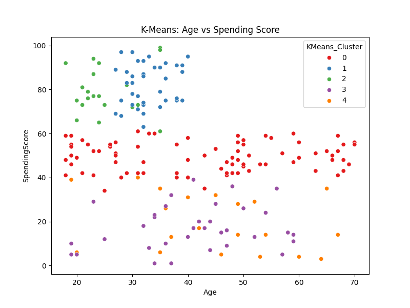

> 2D features (Silhouette **0.5547**) gave much better-separated clusters than the 4-feature version (**0.3144**), so the 2D model is used going forward.

---

## 🌳 Agglomerative Hierarchical Clustering

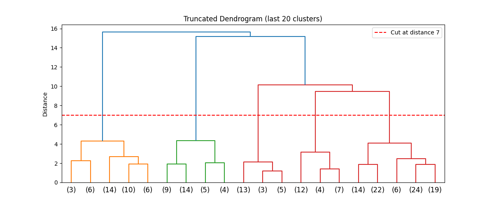

- A horizontal cut at distance ≈ 7 crosses 5 branches → **5 clusters**, matching K-Means.
- Linkage comparison (Silhouette): **Ward 0.5538**, Complete 0.5531, Average 0.4794 → **Ward** selected.
- **98% agreement** with K-Means personas (196 of 200 customers).

---

## 🟣 DBSCAN

### Choosing ε — 4-NN Distance Plot

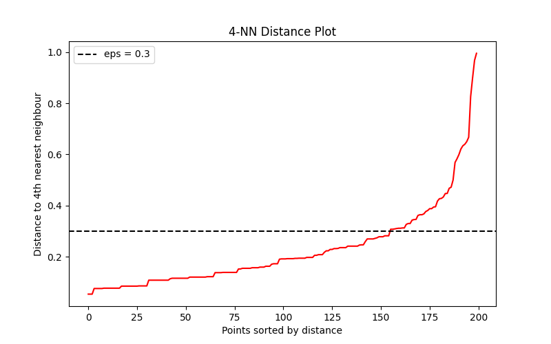

- Initial run (ε = 0.3, min_samples = 4) found 8 clusters + 23 noise points (too fragmented).
- Grid search over ε and `min_samples` gave the best Silhouette at **ε = 0.4, min_samples = 10**: 4 clusters and 51 noise points (25.5%).
- ⚠️ The high score is partly because a quarter of customers are discarded as noise, and the Budget Shoppers segment disappears.

---

## 📈 Algorithm Comparison

| Algorithm | Hyperparameters | Clusters | Silhouette ↑ | Davies-Bouldin ↓ | Calinski-Harabasz ↑ | Noise % |
|---|---|:---:|:---:|:---:|:---:|:---:|
| **K-Means** | k = 5 | 5 | 0.5547 | 0.5722 | 248.6 | 0.0 |
| **Agglomerative** | n = 5, Ward | 5 | 0.5538 | 0.5779 | 244.4 | 0.0 |
| **DBSCAN** | eps = 0.4, min_samples = 10 | 4 | 0.5972 | 0.4734 | 263.6 | 25.5 |

**✅ Recommended: K-Means (k = 5).** DBSCAN scores higher on paper, but only after ignoring 25.5% of customers and losing a whole segment, and it cannot assign new customers. K-Means labels 100% of shoppers, gives a centroid per segment, and is fully **stable** across random seeds (Silhouette 0.5547 ± 0.0000).

---

## 👥 Customer Personas & Retail Strategy

| Segment | Customers | Profile | Retail Strategy |
|---|:---:|---|---|
| 💎 **Big Spenders** | 39 | Age ~33, income 86.5 k$, score 82 | Premium lounge, luxury brand pop-ups, early sale access via mall app |
| 🎯 **Young Aspirers** | 22 | Age ~25, income 25.7 k$, score 79 | Youth/student deal days, fast-fashion pop-ups, app-based points and instalment offers |
| 🛒 **Mainstream Shoppers** | 81 | Age ~43, income 55 k$, score 49.5 | Tiered loyalty program (Silver/Gold) and seasonal sales to nudge them up |
| 🧐 **Careful Spenders** | 35 | Age ~41, income 88 k$, score 17 | Personalised invitations, curated events (premium dining, home & lifestyle) to win back wallet share |
| 💸 **Budget Shoppers** | 23 | Age ~45, income 26 k$, score 21 | Value stores near entrances, coupons via the app, food-court combos |

**Extra data that would improve segmentation:** purchase category and basket data, visit frequency and dwell time, loyalty-app behaviour, store-level transactions, and household/demographic details.

---

## 🚀 Deployment: `classify_shopper()`

The best model (K-Means, 2D) and its scaler are saved with `joblib`:

- `mall_scaler.pkl`
- `mall_segmentation_model.pkl`

```python
import joblib
import pandas as pd

scaler = joblib.load('mall_scaler.pkl')
model = joblib.load('mall_segmentation_model.pkl')

def classify_shopper(age, annual_income, spending_score, gender=None):
    new = pd.DataFrame([[annual_income, spending_score]],
                       columns=['AnnualIncome', 'SpendingScore'])
    cluster = int(model.predict(scaler.transform(new))[0])
    return cluster, persona_map[cluster]
```

**Example predictions**

| Age | Gender | Income (k$) | Spending Score | Persona |
|:---:|:---:|:---:|:---:|---|
| 22 | Female | 30 | 85 | Young Aspirers |
| 45 | Male | 95 | 15 | Careful Spenders |
| 35 | Female | 90 | 88 | Big Spenders |
| 50 | Male | 20 | 10 | Budget Shoppers |
| 40 | Female | 55 | 50 | Mainstream Shoppers |

---

## 📁 Folder Structure

```
mall-shopper-segmentation-unsupervised-learning/
│
├── Dataset/
│   └── Mall_Customers.csv
├── Screenshots/
│   ├── age_vs_spending_score.png
│   ├── annual_income_vs_spending_score.png
│   ├── correlation_heatmap.png
│   ├── dendrogram.png
│   ├── elbow_silhouette.png
│   ├── gender_count.png
│   ├── gender_summary.png
│   ├── histograms.png
│   ├── kmeans_age_spending.png
│   ├── kmeans_clusters.png
│   └── knn_distance.png
├── MallShopperSegmentation_UnsupervisedLearning.ipynb
├── mall_scaler.pkl
├── mall_segmentation_model.pkl
└── README.md
```

---

## ▶️ How to Run

```bash
# 1. Clone the repository
git clone https://github.com/HarshalVora86/mall-shopper-segmentation-unsupervised-learning.git
cd mall-shopper-segmentation-unsupervised-learning

# 2. Install dependencies
pip install numpy pandas matplotlib seaborn scikit-learn scipy joblib jupyter

# 3. Launch the notebook
jupyter notebook MallShopperSegmentation_UnsupervisedLearning.ipynb
```

---

## 💡 Key Takeaways

- Income and spending score alone reveal **5 clear customer segments**; adding age and gender only blurs them.
- K-Means and Hierarchical clustering agree on **98%** of customers, independently confirming the segmentation.
- DBSCAN is useful for spotting fringe shoppers, but is not suitable as the production model here.
- The final K-Means model is stable, interpretable and ready to classify new shoppers instantly.

---

**Author:** [Harshal Vora](https://github.com/HarshalVora86)
